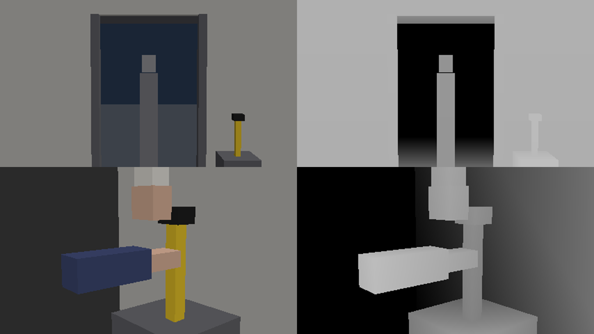

# A2 生成控制方式的演进

AI视频的创作思路，可以按“画面的控制从哪里来”排成一条演进线。每一代没有淘汰上一代，而是在上一代控制不住的地方加入新的输入。理解这条线，比记住某一版工具的参数更持久。本章以 wan3.0-video 的入口说明各阶段，其输入包括：文字；首帧与尾帧图片；参考图片、参考视频与参考音频（参考视频与参考音频各自总长不超过15秒）；首尾帧不能与参考类输入混用。具体参数以官方文档为准。

| 阶段 | 控制来源 | 设计重点 | 主要问题 | 实测结论 |
|---|---|---|---|---|
| ① 文生视频 | 文字提示词 | 提示词结构与否定项，靠多次生成挑选 | 身份、构图、空间都不稳定 | 每条的人物和店面都不同，不能用于多镜叙事 |
| ② 首帧/首尾帧 | 一两张静帧 | 先设计首帧，再写动作 | 静帧本身要一致；过程中仍会走样 | 构图稳定；手部接触、门外路人等状态问题仍常出现 |
| ③ 全能参考 | 多张参考图、参考视频、参考音频 | 给每份参考分配职责，避免互相矛盾 | 参考会被照抄或混淆；不能与首帧同用 | 人物与店面跨镜一致；空间状态仍管不住 |
| ④ 结构控制 | 深度图、白模动画等几何与运动参考 | 先在三维里定机位、走位、运动，再生成外观 | 前期制作成本高 | 站位与轨迹被锁住，门外路人消失；动作停住后的状态仍会漂 |
| ⑤ 声画同生 | 声音与画面同时生成，或由参考音频驱动 | 台词与音效进入生成环节 | 跨镜音色一致性、多说话 | 口型与语音相差约0.1秒；需逐条核对台词 |

### 按缺少的控制选路

下面是工作流选路，不是某个服务的功能承诺。执行前填写[工具能力卡](../guide/05-sources-and-terms.md)，确认所用工具确实支持对应输入。

| 路线 | 适用任务与要准备的输入 | 一次最小预试 | 失败后怎么改 |
|---|---|---|---|
| 文生视频 | 还在探索氛围、空间或非精确物体；先写镜头目的、主体、动作、机位、声音职责 | 只测一个固定镜头；检查输出是否表达目标、是否凭空增添人物道具 | 若具体身份或布局重要，先制作批准静帧，转图生/参考或受控制作 |
| 图生视频 | 起始构图、人物造型或道具外观已明确；输入干净起始图及运动说明 | A13-03 用“伞在架上、手尚未入画”的起始图，按提示让手进入后停住；检查起始、运动及终点，不能只看首帧 | 减少动作、拆成反应镜，或将手与伞分别制作合成；起始图一致不代表过程一致 |
| 多参考驱动 | 需要在不同机位保持角色、场景、道具；分别提供身份、布局、物件参考并注明职责 | 对同一角色做中景和近景，检查脸、服装、伞数量及空间，不只评一张首帧 | 清理互相矛盾的参考；不支持多参考时先合成目标机位静帧再动画化 |
| 首尾/关键帧控制 | 明确知道状态A到状态B，且工具支持相应关键帧；输入相容的姿态、布局与预计时长 | A13-03可给空手起点和“指尖距柄有间隙”终点，检查中间进入路径；A13-04可给望门/看陈两姿态，检查中间头颈转动 | 缩短位移/旋转或增加可控中间状态；不支持时用传统关键帧动画或分镜剪接 |
| 运动/视频参考 | 需要明确动作节拍或摄影机轨迹；准备自制动作预演，说明是借运动而非替换事实 | 单独测主体运动或相机运动，避免同时改变二者 | 若连身份、背景也被带走，分层制作，或将运动要求简化为固定机位 |
| 混合合成 | 产品、文字、接触或局部结构必须精确；准备可控主体、背景、遮挡和跟踪信息 | 先做一小段合成，检查透视、边缘、光影和运动模糊关系 | 难以统一时转同一制作路径；不要靠色调一致假装空间成立 |

以本章为例：A13-01先用布局图确定两人和伞；A13-02用门口批准静帧及周的微动作；A13-03先做最危险的手部预试；A13-04若有可靠姿态控制再用起止帧。不是六种路线全部用一遍，而是为缺少的控制增加输入。若只允许文本，降低设计自由度并严格筛选；不要把无支持入口的参数名称当成已生效的控制。

## A2-01 文生视频：控制只在文字里

**定义与机制。** 只给文字时，模型要自己决定人物长相、空间布局和构图。提示词能可靠影响的是氛围、大致动作和镜头类型，很难保证跨镜头是同一个人、同一家店。

**适用与限制。** 适合探索方向、做情绪板和非叙事的氛围镜头；不适合多镜头的人物叙事。

**操作。** 提示词按“主体—动作—机位与景别—光色—固定项—否定项”的顺序写；一镜一个动作；否定项只写真正出现过的问题。生成多条候选后按[失败分类](A3-consistency-yield.md#a3-03-实测抽卡率与失败分类)挑选，而不是反复改形容词。

**检查。** 是否凭空增加了人物或道具？动作是否完成？结果若要进入多镜叙事，先转为批准静帧，走下一阶段。

**实测。** 同一个“陈指伞、林看伞”的镜头只给文字生成两次，两次的人物长相和店面布局都不一样，货架上还冒出了可读文字。纯文生不能用于需要同一人物、同一空间的多镜叙事。

<figure class="vid"><video controls preload="metadata" src="../../assets/ai/control-compare/X-t2v-c01.mp4"></video><figcaption>纯文生：人物和店面由模型自己决定</figcaption></figure>
## A2-02 首帧与首尾帧：先设计一张图

**定义与机制。** 首帧把构图、人物外观和起始状态一次固定下来，模型只负责“从这张图开始动”。尾帧再固定终点状态，过程交给模型补。控制力从文字转移到图片，所以设计重点也从写提示词转为设计首帧。

**首帧设计要点。**
1. **构图就是景别。** 首帧是什么景别，视频就是什么景别，提示词很难再改。
2. **画动作开始前的一刻。** 首帧里人物还没开始做事，动作留给视频完成。
3. **只放需要出现的东西。** 首帧里多一把伞、门外多一个人，视频里大概率保留甚至放大。
4. **首帧由同源参考派生。** 先做整场主参考，再派生各镜首帧；近景首帧只给对应的近景参考，否则会照抄主参考的构图（见[A3-01](A3-consistency-yield.md#a3-01-跨镜一致性同源参考与派生)）。

**首尾帧的用法。** 当中间过程容易出错、而终点状态可以画出来时用首尾帧。“手伸向伞柄后停住、不碰到”这个镜头，只改提示词两次都失败，手指压到了伞柄上；单独画一张“手停住、留有间隙”的尾帧后，第一次就通过。灰盒也没做到的终止状态，首尾帧可以补。

<figure class="vid"><video controls preload="metadata" src="../../assets/ai/pilot-a13/A13-03-c01.mp4"></video><figcaption>只用首帧：手指压到伞柄上</figcaption></figure>
<figure class="vid"><video controls preload="metadata" src="../../assets/ai/pilot-a13/A13-03-c03.mp4"></video><figcaption>首帧＋尾帧：手停在柄前，留出间隙</figcaption></figure>
首尾帧用同一张静帧时，可以锁住人物和机位，适合动作很小的镜头，例如防止近景中途自己切到全景；但它挡不住背景里新冒出来的路人。

**检查。** 起点和终点是否符合契约？过程中是否穿过不该穿过的状态？

## A2-03 全能参考：给每份参考分配职责

**定义与机制。** 参考类输入不规定第一帧长什么样，而是告诉模型“谁长什么样、场景是什么、动作或声音参照什么”。好处是可以同时提供人物、场景、道具、运动和声音参考；代价是模型自己决定构图，参考之间如有矛盾会互相干扰。

**操作。** 每份参考只负责一件事，并在提示词里写明“参考图1是人物、参考图2是场景”；人物参考用干净背景的正侧面；运动参考只用于运动，不带入外观；参考音频用于台词与音色。wan3.0 中参考类输入不能与首尾帧同用，需要固定构图时仍回到首帧路线。

**实测。** 把整店、林、陈、伞架分成四张参考图并逐张写明职责后，“陈指伞”两条都通过，人物和店面与参考一致，构图按文字描述走。但“周在门外、门外没有路人”和“两只手不碰伞”各两条全部失败，和纯文生、首帧路线的失败一样。全能参考解决了“是谁、在哪”，管不住空间状态。

<figure class="vid"><video controls preload="metadata" src="../../assets/ai/control-compare/X-ref-c01.mp4"></video><figcaption>全能参考：人物与店面跟参考一致</figcaption></figure>
<figure class="vid"><video controls preload="metadata" src="../../assets/ai/control-compare/Y-ref-c01.mp4"></video><figcaption>全能参考：门外仍冒出撑伞路人</figcaption></figure>
**参考图也决定构图。** 对话镜头如果只给一张双人全景参考，单人近景会被画成双人中景；换成景别正确的单人参考后全部通过。给参考时，参考的景别要和目标镜头一致。另外，参考图加参考音频的近景对白镜头，容易在镜头中途自己切机位，加约束无效，退回首帧路线后才稳定。

**参考音频。** 用参考音频让人物说指定台词，可以保持同一角色的嗓音；但模型偶尔会在台词后多编一句话。提示词要写“只说这一句、说完保持沉默”，生成后用语音识别逐条核对。

## A2-04 结构控制：先定几何与运动，再生成外观

**定义与机制。** 前几代的空间关系和运动都由模型猜。结构控制先在三维软件里用白模（无材质的简单几何体）搭好场景、走位和机位，渲染出灰盒视频或深度图，再作为参考视频交给模型，让模型只负责“画皮”：人物外观、材质与光色。空间关系与运动由几何决定，最适合解决“周不能进店”“两手不能接触”这类状态问题。

**适用与限制。** 适合空间关系、运动轨迹或相机运动必须精确的镜头；代价是需要先做三维布局与动画。参考视频会同时带入构图与运动，外观仍需提示词或参考图控制。

**实测。** 灰盒不一定要用 Blender。这里用一个几百行的程序渲染器（[greybox.py](https://github.com/dwp7399/video-create-book/blob/main/scripts/greybox.py)）按真实尺寸搭出便利店、人物和伞，输出灰盒视频，再连同人物参考图交给 wan3.0：

- **wan3.0 几乎原样照搬参考视频的构图与运动。** 提示词只写“按参考视频生成”时，输出就是灰盒本身；必须写明“把几何体替换为写实外观”。
- **背景问题解决了。** “周在门外等候”在前三种路线里每次都冒出门外撑伞路人；用灰盒参考后4条都没有路人，周始终站在门外。
- **轨迹能锁住，停住后的状态较弱。** “两手挡伞”前约3秒照着灰盒的轨迹走，停住后手仍会去碰伞或碰到对方的手。
- **灰盒画面比深度图好用。** 深度图只有明暗，人物可能被画成一根柱子；灰盒用颜色区分人物、手臂和伞，模型更容易对应。几何体的形状和比例也会被照搬，要尽量接近真实物体。
- **两条使用规则。** 灰盒和参考音频不要同时给，否则方块会残留在画面里，灰盒镜头的台词改成画外、剪辑时再铺入；手部灰盒的提示词只写“黄色细长体是伞杆、深蓝长条是陈的手臂”这样的对应关系，附上分镜原文反而会出错。

<figure class="vid"><video controls preload="metadata" src="../../assets/ai/greybox/Y-grey.mp4"></video><figcaption>灰盒参考：周在门外</figcaption></figure>
<figure class="vid"><video controls preload="metadata" src="../../assets/ai/greybox/Y-grey-c02.mp4"></video><figcaption>生成结果：门外没有路人，周始终在门外</figcaption></figure>
<figure class="vid"><video controls preload="metadata" src="../../assets/ai/greybox/Z-grey.mp4"></video><figcaption>灰盒参考：两只手停在伞柄前</figcaption></figure>
<figure class="vid"><video controls preload="metadata" src="../../assets/ai/greybox/Z-grey-c02.mp4"></video><figcaption>生成结果：前段照轨迹，停住后手指落到对方手上</figcaption></figure>
**操作。** ①在三维里按真实尺寸搭场景，人物、关键道具用不同颜色。②先从机位看一遍灰盒：三维里不接触、画面里却重叠，也会被画成接触，要调整机位。③参考视频＋人物参考图＋提示词，提示词写明“参考视频只提供构图、位置与运动”。④停住后容易漂的动作，缩短停顿或在灰盒里加大间距。

## A2-05 声画同生：声音进入生成环节

**定义与机制。** 后配声音时，台词和动作声只能按计划时点放，而生成画面里的张嘴与接触时刻并不遵守计划，声画必然错位。让模型同时生成声音，口型和撞击声由同一次生成决定。

**实测。** 先生成无声画面、再按分镜秒数配上台词和动作声，台词文字全对，但口型和动作都对不上。改为声画同生后，口型与语音起点相差约0.1秒，碰杯声比画面接触晚约0.2—0.3秒；开声音后，之前无声生成时常见的乱码字幕也没再出现。

<figure class="vid"><video controls preload="metadata" src="../../assets/ai/av-pilot/D0-01-R1.mp4"></video><figcaption>声画同生：提示词里写出台词</figcaption></figure>
<figure class="vid"><video controls preload="metadata" src="../../assets/ai/av-pilot/D0-01-R2.mp4"></video><figcaption>声画同生：用参考音频保持角色嗓音</figcaption></figure>
**无对白镜头会冒出人声。** 没有台词的镜头，模型常自己编几句话。在提示词里写“没有人声”没有用；把同场的雨声或室内底噪作为参考音频传入后，这类镜头全部干净。

**操作。** 无对白镜头在提示词里写清环境声与动作声；有对白镜头写出台词原文，或用参考音频保持角色音色；生成后用ASR核对台词，用加密抽帧核对口型与接触时刻，见[A4-03](A4-post-review.md#a4-03-自动核对抽帧asr与能量曲线)。

## 本章实践交付

为一场戏的每个镜头标注所用阶段（①—⑤）及理由：缺的是哪种控制，就加哪种输入。交选路表、各阶段输入清单与对应的检查方式；没有实测过的路线标“待验证”。
