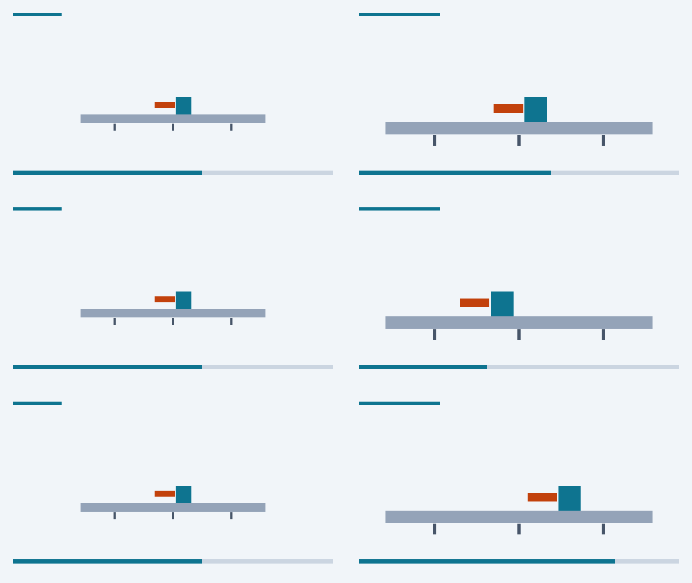

# 动作连续性：重复、缺失与修复

对应[动作案例：切过去以后，动作从哪里继续](../cases/09-action-continuity.md)。一个蓝色方块被沿桌面从左推到右，4秒处从远景切到近景。三版只差切点后动作从哪一帧接上。

<figure class="vid"><video controls preload="metadata" src="../action-continuity/continuous.mp4"></video><figcaption>连续版：动作正确接上</figcaption></figure>
<figure class="vid"><video controls preload="metadata" src="../action-continuity/repeat.mp4"></video><figcaption>重复版：切过去后重演了一段</figcaption></figure>
<figure class="vid"><video controls preload="metadata" src="../action-continuity/skip.mp4"></video><figcaption>缺失版：切过去后跳过了一段</figcaption></figure>


图中每行左边是切点前一帧，右边是切点后一帧；上方的短线和长线表示远景和近景，下方进度条表示动作进行到哪里。

## 三版的差别

| 版本 | 切点后接哪一帧 | 结果 |
|---|---|---|
| 连续版 | 接着第96帧 | 动作连续 |
| 重复版 | 退回第72帧 | 重复24帧（1秒） |
| 缺失版 | 跳到第120帧 | 缺失24帧（1秒） |

三版前4秒完全相同，最终也都到达同一位置，只是到达的时刻不同。全片无声，以便只看画面。

## 局限

这是用几何动画演示的“源时间错误”，用来说明怎样从动作阶段找切点，不是自动检测任意视频动作错误的工具。

重建：

```sh
python3 scripts/build_action_continuity.py
```
