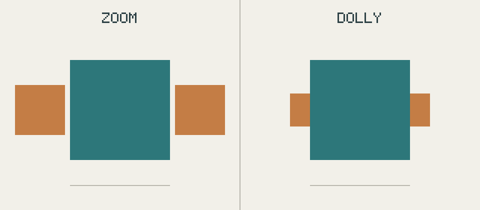
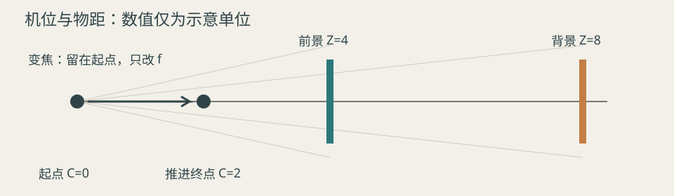

# 推近与变焦：主体一样大，背景却不同

对应[科普教程案例](../cases/08-perspective-tutorial.md)。左边相机不动、镜头变焦；右边焦距不变、相机推近。两边的前景方块每一帧都一样大，只有背景的大小不同。

<figure class="vid"><video controls preload="metadata" src="../dolly-zoom/comparison.mp4"></video><figcaption>12秒对照：左变焦，右推近</figcaption></figure>

## 设置

青色前景和两个橙色背景方块都是1单位宽，前景距离4、背景距离8。开始时两边相同；0—2秒停留，2—8秒变化，8—12秒停留。全片无声。

- 左：相机不动，焦距从1倍变到2倍。
- 右：焦距保持1倍，相机前进2个单位。
- 为了让前景每一帧都等大，左边的焦距按 `4/(4-C)` 随右边的相机位置 C 变化。

## 为什么背景不一样

理想针孔投影下，`画面宽度 = 400 × 焦距 × 物体宽度 / (物体距离 − 相机位置)`：

| 项目 | 开始（两边相同） | 变焦结束 | 推近结束 |
|---|---|---|---|
| 前景宽度 | 100px | 200px | 200px |
| 背景宽度 | 50px | 100px | 约66.67px |
| 背景／前景 | 0.5 | 0.5 | 约0.33 |

变焦只是把整个画面放大，前后景比例不变；推近改变了相机与前后景的距离，比例也随之改变。

## 局限

这是理想几何模型，没有模拟景深、畸变、镜头呼吸和运动模糊，只用来解释投影关系。

重建：运行[build_additional_demos.py](https://github.com/dwp7399/video-create-book/blob/main/scripts/build_additional_demos.py)。起点画面见[start.png](dolly-zoom/start.png)，参数见[verification.json](dolly-zoom/verification.json)。
