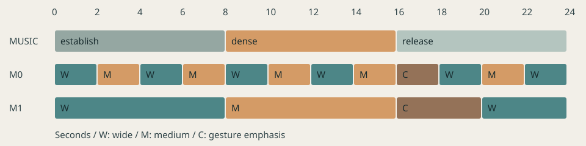

# 音乐动作：同一段音乐的两种剪法

对应[音乐动作案例](../cases/06-music-phrases.md)。人物是几何符号，音乐是程序合成的短音动机，两版用同一段音乐、同一套动作，只改取景和切换时点。

<figure class="vid"><video controls preload="metadata" src="../music-phrases/M0.mp4"></video><figcaption>M0：每小节切换一次，12个镜头</figcaption></figure>
<figure class="vid"><video controls preload="metadata" src="../music-phrases/M1.mp4"></video><figcaption>M1：按乐句段落安排，4个镜头</figcaption></figure>
单独听音乐：[music.wav](music-phrases/music.wav)。

## 结构

音乐120BPM、4/4拍，每小节2秒，三个8秒段落：

- 0—8秒：四次“展开—收回”，建立动作动机。
- 8—16秒：动作密度加倍并横移；音乐加入八分音符层。
- 16—24秒：16—18秒缓慢展开，18—21秒保持，21—23秒收回，23—24秒静止；音乐撤去密集层。

M0 并不是每一拍都切，而是每小节切一次。

## 素材

- 三种机位的完整覆盖：[全景 W](music-phrases/coverage-W.mp4)、[中景 M](music-phrases/coverage-M.mp4)、[手势近景 C](music-phrases/coverage-C.mp4)，各24秒、无声。
- 两版无声剪辑：[M0](music-phrases/M0-picture.mp4)、[M1](music-phrases/M1-picture.mp4)。
- [关键状态图](music-phrases/keyframes.png)：1、9.5、12.5、17、20、23.5秒。

C 机位只在16—20秒用于成片，其他时段不保证可用。

## 局限

几何人物的四肢长度会随手势变化，横移也不是写实步态；取景是同一个二维画面的缩放，不代表真实镜头透视。哪一种剪法更有感染力，要靠观看判断。

重建：`python3 scripts/build_music_demo.py`，脚本见[build_music_demo.py](https://github.com/dwp7399/video-create-book/blob/main/scripts/build_music_demo.py)。
