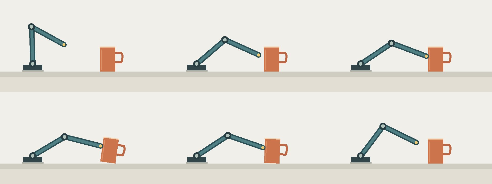

# 声音对照：同一动作，三种声音

对应[声音案例：同一动作，怎样听出不同意图](../cases/05-sound-priority.md)。一段16秒的二维动画：机械臂靠近杯子、碰歪它、再把它扶正。画面三版完全相同，只有声音不同。画面由程序绘制，所有声音由程序合成，没有使用录音。

## 怎么看

- [S0：动作细节充分](sound-priority/S0.mp4)
- [S1：降低竞争细节](sound-priority/S1.mp4)
- [S2：在 S1 上替换扶正段的运动音色](sound-priority/S2.mp4)
- [无声画面](sound-priority/picture.mp4)

一次只打开一个版本，用同一设备和音量播放。第一次看之前不必读下面的说明：先记下发生了什么、哪些声音抓住了你的注意，再比较版本。

## 画面与时间

16秒、24fps，固定的二维侧视。0—5秒靠近，5秒接触；5—5.7秒杯子偏斜，5.7—8秒保持；8—11秒扶正，11—12秒撤开；12—16秒保持。没有字幕、对白、旁白和音乐。



## 三版改了什么

| 比较 | 不变 | 改变 | 注意 |
|---|---|---|---|
| S0→S1 | 画面、环境声、接触声、运动声 | 4.5—12秒逐渐压低零件细节声，最低保留18% | 差别在小音箱上可能不明显 |
| S1→S2 | 画面、环境声、接触声、减弱后的细节声 | 8—11.25秒用带气息感的声音逐步替换电机声 | 音色和响度感会一起变化，不能只归因于“拟人化” |

替换用约0.25秒的过渡；12秒以后三版只剩相同的环境声。三版没有分别做响度归一，整体响度略有不同。

## 分轨

分轨为48kHz、单声道、16-bit WAV，每条16秒、从0秒对齐：

| 轨道 | 文件 | 内容 |
|---|---|---|
| ENV | [环境](sound-priority/ENV.wav) | 低幅度的平滑底噪 |
| CONTACT | [接触](sound-priority/CONTACT.wav) | 5秒的碰撞短音与8—11秒的轻摩擦 |
| MOTOR | [运动](sound-priority/MOTOR.wav) | 动作期间的电机声 |
| DETAIL | [零件细节](sound-priority/DETAIL.wav) | 动作期间的周期性短音 |
| AIR | [气息质感](sound-priority/AIR.wav) | 带限噪声，不是人声或呼吸录音 |

完整混音：[S0](sound-priority/S0.wav)、[S1](sound-priority/S1.wav)、[S2](sound-priority/S2.wav)。

## 重建

```sh
python3 scripts/build_sound_demo.py
```

只需要 Python 标准库与 FFmpeg。脚本见[build_sound_demo.py](https://github.com/dwp7399/video-create-book/blob/main/scripts/build_sound_demo.py)，参数记录见[verification.json](sound-priority/verification.json)。

## 局限

数值检查只能说明三版画面完全相同、声音没有削波、首尾段相同；“哪一版更温柔、更清楚”要靠你自己听。
