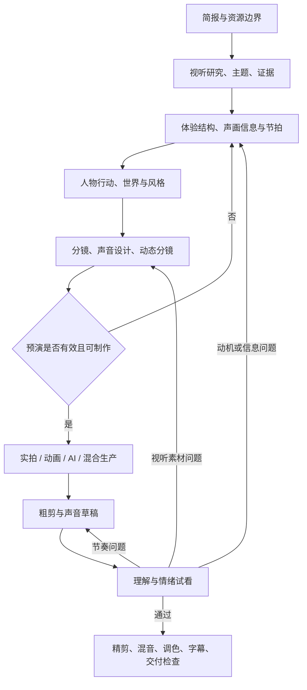

# 创作维度地图与方法论

本页说明全书怎样分类：先按创作决策分域，再用类型、媒介、渠道等标签交叉组合。

## 分类原则

按“需要做的创作决策”组织主目录，按“适用条件”添加标签。每个知识点只有一个主归属，其他章节通过链接引用；不要将同一个知识点在摄影、剪辑、AI 章节各讲一遍。

主目录回答六类问题：为什么做；表达什么；观众何时知道什么；观众看到和听到什么；如何生产；如何知道有效。风格是跨维度约束，类型是应用路径，实拍/动画/AI 是生产方式，不与景别、三幕式等技法混排。

## 维度地图

| 层级 | 维度 | 关键决策 | 应留下的产物 |
|---|---|---|---|
| 目标与约束 | 受众、场景、平台、用途、预算、时长 | 谁在什么情境下看；希望理解、感受、行动什么 | 创作简报、成功标准 |
| 内容与研究 | 主题、前提、素材、事实、观点、证据 | 作品提出什么；能用什么证明或呈现 | 主题句、素材与证据表 |
| 体验组织 | 叙事、论证、流程、观察、联想、音乐与运动形式 | 信息次序、视点、人物目标、因果或非因果连接 | 节拍表、信息曲线、证据顺序/步骤表 |
| 人与世界 | 人物关系、表演、时代空间、美术、文化语境 | 谁在何种世界中如何行动 | 人物小传或对象状态表、动作任务、世界规则 |
| 视听呈现 | 调度、镜头、构图、光色、运动、声音、文字 | 每个时刻让观众注意什么及如何感知 | 分镜、声音图、风格说明 |
| 时间与组合 | 节奏、剪辑、蒙太奇、声画衔接 | 动作、信息、声画事件何时变化；相邻信息如何相互解释 | 动态分镜、粗剪、节奏修订记录 |
| 生产执行 | 实拍、动画、AI、混合、资产、协作 | 用什么手段稳定实现；成本与返修如何控制 | 镜头清单、资产表、日程、版本与交付 |
| 评价与迭代 | 理解、情绪、表达、技术、可访问性 | 哪些问题阻碍目标；回到哪层修改 | 试看记录、问题单、验收报告 |

贯穿项：风格一致性、空间连续性、时间连续性、信息可读性、资源可行性、素材来源与使用许可、纪实可信度、文化表达及可访问性。它们在立项时设要求，在制作中留记录，在交付时验收，不能只在末尾补救。

## 四个容易混淆的概念

| 概念 | 回答的问题 | 例子 | 不能替代什么 |
|---|---|---|---|
| 叙事结构 | 事件与信息以何种次序、因果和比例被理解 | 先见结果再追溯原因；三幕；限制观众知情 | 无法替代演员的具体行动或镜头空间 |
| 影像风格 | 哪些感知选择在全片持续出现，并服务何种态度 | 克制观察：固定机位、少切、自然空间声、低干预表演 | “电影感”等标签不能成为拍摄指令 |
| 镜头技法 | 单镜头中如何组织视点、空间、注意力和运动 | 近景揭示手部犹豫；横移逐渐显露门后的人 | 无法自行补足故事动机或相邻镜头关系 |
| 制作工具 | 用什么系统实现这些选择 | 相机、灯具、剪辑软件、动画软件、生成模型 | 工具名称不解释观众为何紧张或理解什么 |

例：想让观众担心“女孩能否归还失物”。结构先让观众看见失主离开的倒计时；风格用克制观察避免英雄化；镜头用前景失物与远景出口建立距离；剪辑在女孩迟疑与出口之间切换；声音让离站提示提前进入；实拍、动画或 AI 分别承担实现。换一款工具不必改变结构，但工具无法完成长镜头时，拆镜会改变信息揭示时间，需要重新检验体验。

## 从创意到成片的循环

声音从简报、视听素材研究和创意阶段进入；分镜将声源、时间与空间关系具体化。剪辑在拍摄前预演，预算在立项时介入。流程图表达主要依赖，不代表各部门必须等前一部门完全结束才开始。

每一步使用同一条判断链：**目标 → 观众当前掌握的信息 → 希望发生的变化 → 视听手段 → 制作方法 → 检查证据**。不从“想用一个很酷的运镜”跳过中间决策。

## 与图片创作共通与视频独有的知识

| 共通基础 | 在视频中增加的问题 | 实践检查 |
|---|---|---|
| 构图、视觉层级、负空间 | 关注点随时间和动作转移 | 连续播放是否能追踪关键对象 |
| 色彩、明暗、材质、造型 | 跨镜头匹配、情绪弧线、闪烁 | 相邻镜头中肤色、道具和光线是否合理延续 |
| 透视、尺度、空间关系 | 轴线、视线、进出画、运动方向 | 观众能否复述谁在哪里、向哪走 |
| 主题与视觉隐喻 | 伏笔、重复、变奏、回收 | 第二次出现是否改变第一次的意义 |
| 单帧形象一致性 | 形体、身份、接触关系随时间稳定 | 手握杯时是否贯穿动作且不穿透 |
| 图文层级 | 阅读时长、出现先后、与声音竞争 | 不暂停能否读懂；是否挡住关键动作 |
| 单幅风格体系 | 镜头组合、时间节奏、表演、声音视点 | 按观看目标做只听声音、静音及合看诊断，检查各通道的信息职责 |

单帧漂亮只说明某一时刻的视觉表现。视频验收还必须覆盖持续运动、时间因果、剪辑意义、声音、同步及观看环境。

## 场景与段落设计桥梁

从结构到单镜头先填写：进入状态 → 退出状态；观众初始/结束知情；人物或对象行动；空间关系；声音事件；注意转移；必要覆盖；制作约束。教程的一次操作、MV 的一个音乐段落和纪录片的一段观察均可使用此表，不必虚构人物冲突。

时间与节奏横跨结构、动作、声音和剪辑。连续性是帮助定向的默认手段；有意偏离要记录目的、保留的必要线索和观看反馈，不能凭“风格化”免除检查。
